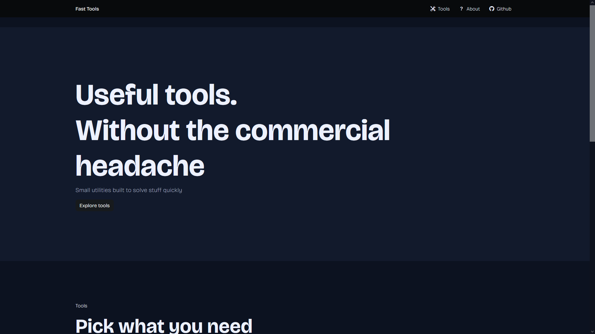
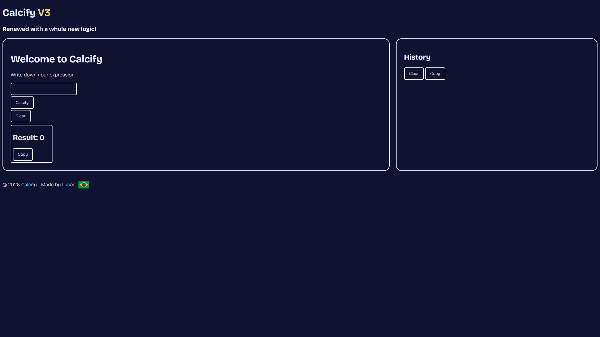
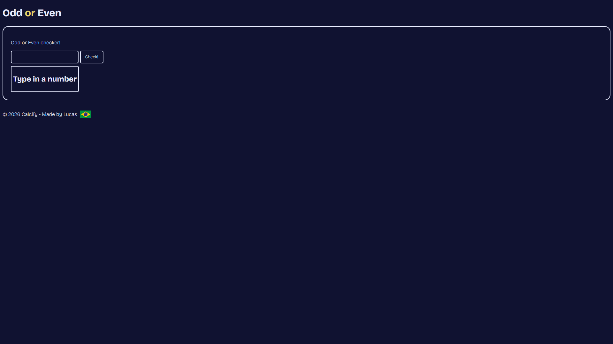
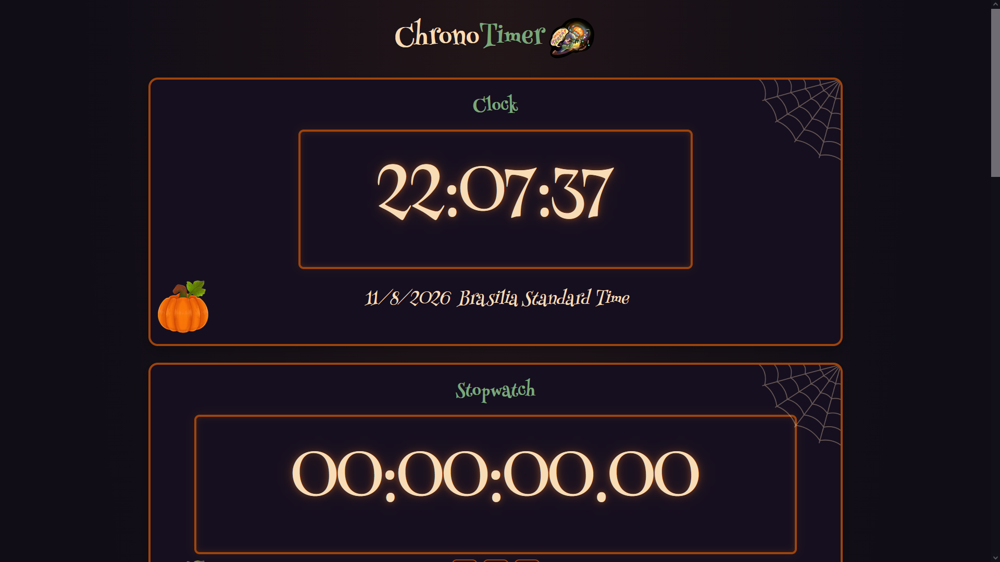

# Fast Tools

A Simple tools hub with a big use on a daily routine!

Fast Tools is a collection of small tools I made to make everyday tasks a little easier. It currently has Chrono, a time utility; Calcify, a calculator with its own expression engine and step-by-step calculations; and Odd or Even, a simple number checker. I built everything using HTML, CSS, and JavaScript, with Lucide and Bootstrap for icons and some styling. You don't need to install anything to use it, just open the [website](https://wirum.github.io/Fast-Tools/), pick a tool and start using it!

## Features

- Timer and chronometer on Chrono, with lap times and real time clock (based on your UTC time)
- Step-by-step calculation on Calcify with **HowTo**
- Odd/even checker

## Technologies

- HTML
- CSS
- JavaScript

Uses Bootstrap for the icons and some other styling.

## How to use

Open the first index or open the website [Here!](https://wirum.github.io/Fast-Tools/)

## Screenshots

### Current

### Current Calcify

A custom-built calculator with a dedicated expression engine, calculation history, and useful tools for everyday math.

### Current Odd or Even

A simple tool that checks whether a number is odd or even, with a clean and straightforward interface.

### Current Chrono

A time utility featuring a live local clock, stopwatch with lap tracking, countdown timer, and Pomodoro timer.

## License

MIT License.
