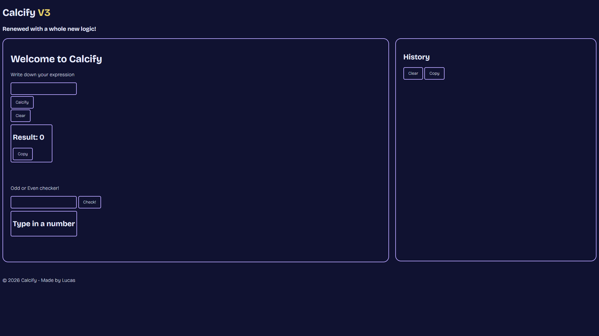
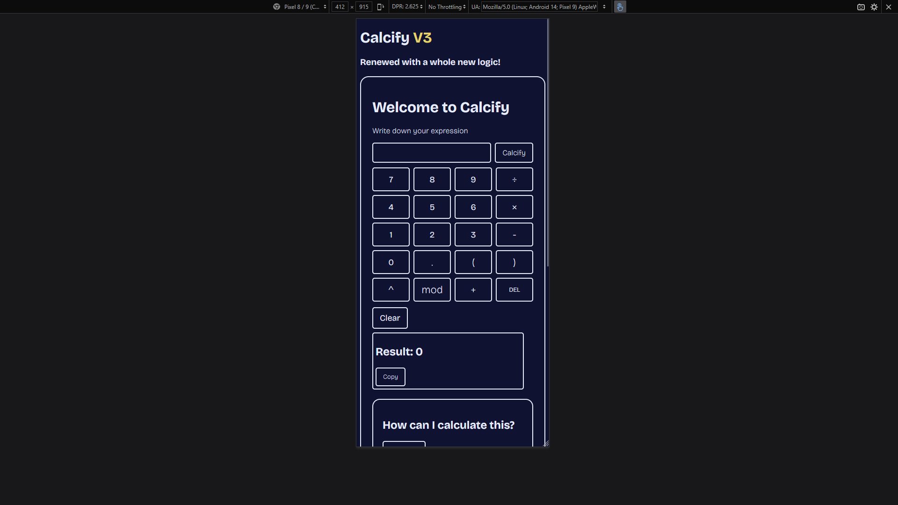
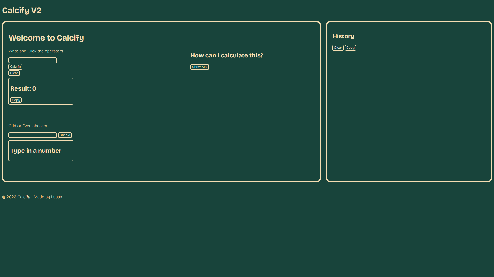
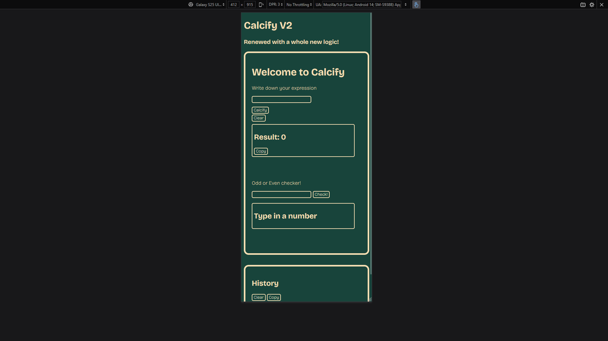
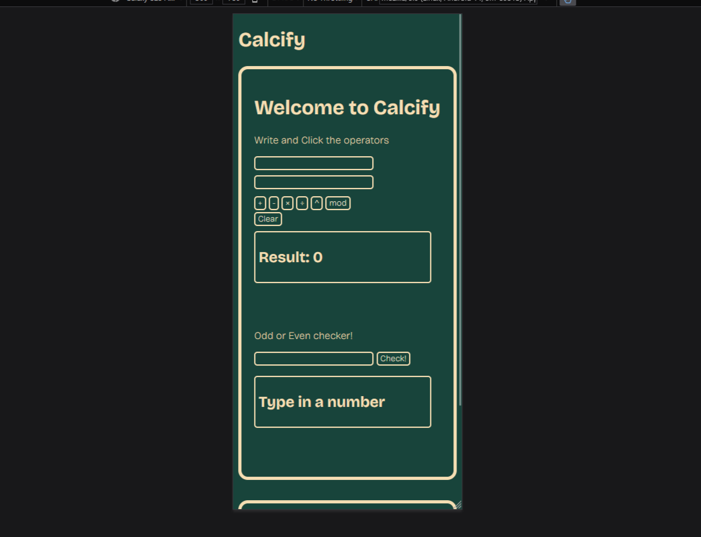
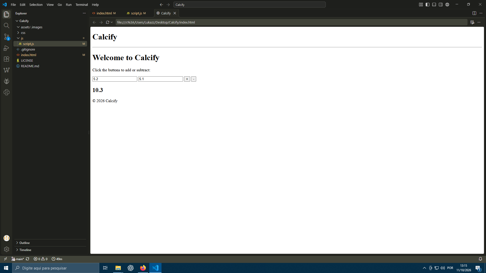

# Calcify

A browser-based JavaScript calculator built from scratch, featuring a custom expression evaluator, calculation history, step-by-step explanations, and more.

Calcify started as a simple calculator and eventually became a much bigger project with its own tokenizer and expression evaluation logic, built without using `eval()`.

## Features

- Basic arithmetic operations
- Power and remainder operations
- Operator precedence
- Parentheses and nested parentheses
- Unary positive and negative numbers
- Custom expression tokenizer and evaluator
- Step-by-step calculation with **HowTo**
- Odd/even checker
- Calculation history
- Persistent history using `localStorage`
- Copy results and history to clipboard
- Decimal support, including decimal commas
- Responsive layout

## Technologies

- HTML
- CSS
- JavaScript

No frameworks are required. The expression evaluator was built from scratch in JavaScript without using `eval()`.

## How to use

Type the expression you want to Calcify and click the calculate button. Your result will be displayed along with the option to view the calculation step by step using **HowTo**.

For example:

`2*(3+4)-5`

Calcify evaluates the expression following operator precedence and parentheses:

`2*(3+4)-5`  
`2*7-5`  
`14-5`  
`9`

There's also an **Odd or Even checker**. Enter a number and click **Check!** to see the result.

## Screenshots

### Current V3

### Past versions

## What I learned

I learned **JavaScript in practice**, which I hadn't really used before! I worked with APIs such as the **Clipboard API**, and learned about alerts, functions, syntax, value handling, and a lot more... haha.

I also practiced a bit of **responsive CSS**, which I hadn't worked with much before.

I already had a lot of previous experience with **HTML**, so there wasn't that much new for me there.

With **V2**, I learned **SO MUCH STUFF**. I had to build an entire expression-evaluation system to avoid using `eval()`. I basically made my own evaluator... hah.

*(help, I barely knew JavaScript two weeks ago)*

## Running locally

You can clone or download the project and open `index.html` in your browser.

You can also use the live version here: (currently V2)

[Open Calcify](https://wirum.github.io/Calcify/)

## Versions

### V1

The first complete version of Calcify, featuring basic arithmetic operations, power and remainder, an odd/even checker, calculation history, `localStorage` persistence, clipboard support, input validation, and a responsive interface.

### V2

A major rewrite of the calculator engine.

V2 introduced a single-expression input and a custom evaluation system with tokenization, operator precedence, nested parentheses, unary operators, right-associative exponentiation, and the visual **HowTo** system.

The evaluator was built manually instead of relying on JavaScript's `eval()`.

### V3 (to be released)

A full on hub for Calcify engine.

Made **Fast Tools**, a tiny hub including Calcify, Even or Odd, and Terra Tracker, and to be added more tools, reviewed acessibility, and separated Even or Odd from Calcify

Also reviewed Calcify itself, adding acessibility and more mobile integration. (also new css)

## Fast Tools Visual Identity

- Dark navy background
- Cyan primary accent
- Lavender secondary accent
- Bricolage Grotesque
- Rounded cards
- Low-opacity thematic background art
- Subtle hover movement

## License

MIT License.