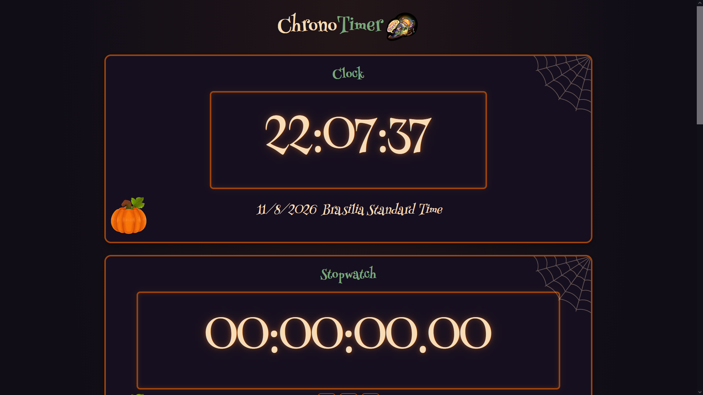
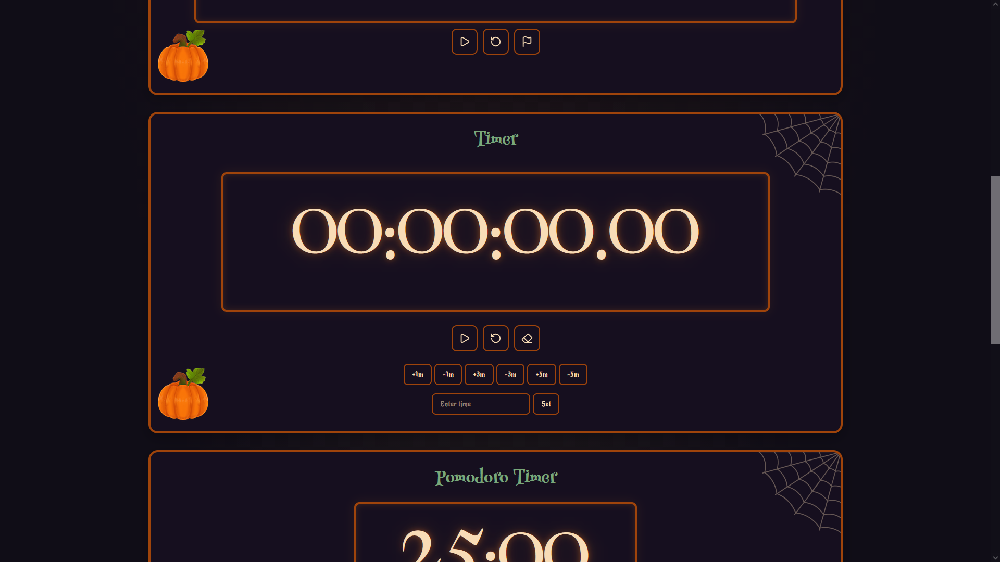

# Chrono

Fast-tool's time utility!

## Features

- Timer
- Stopwatch
- Pomodoro
- Live Local time

## Technologies

- HTML
- CSS
- JavaScript

Uses lucide's icons.

## How to use

Open the direct tool link [Here!](https://wirum.github.io/Fast-Tools/tools/chrono/index.html)

### UTC Clock

You don't need to do anything, just open the website and it should show!

### Stopwatch

The first button toggles the stopwatch (running/stopped)
The second button resets the stopwatch
The third and last one marks a lap (reset clears the laps)

And they save on local storage.

### Timer

Enter the time using the `HH:MM:SS.CC` format (Hours : Minutes : Seconds . Centiseconds) or natural shortcuts like `2h 30m 20s` / `15m`

After entering the time, click **Set**, then press the **Play** button.

Quick-add minute buttons can be clicked at any time, even while the timer is running.

Use the clear button on the right to reset the input back to zero.

### Pomodoro Timer

The classic pomodoro.

Now supporting the same flexible input format as the timer!

Break durations scale proportionally to your focus time (automatically set to 20%. For example, a 25 minute focus session gives a 5 minute break, while 50 minutes would give 10).

Play and Reset buttons work just like the other modules, smoothly alternating between  **FOCUS** and **BREAK** states.

## All of the timers/stopwatch contain the keyboard shortcuts

### R to reset
### Space to start (default is stopwatch)

## Screenshots

### FOR THE REVIEWER

Im open to suggestions! If you see anything that could be done different im more than eager to hear!

## AI USE

Used just a bit for the CSS, the more complex gradients and the glow animation.

## License

MIT License.
