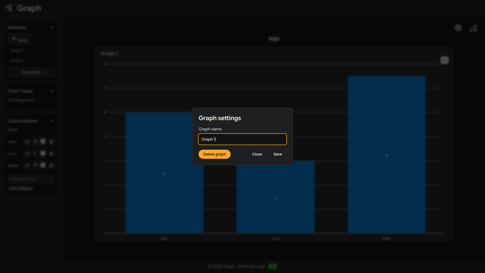
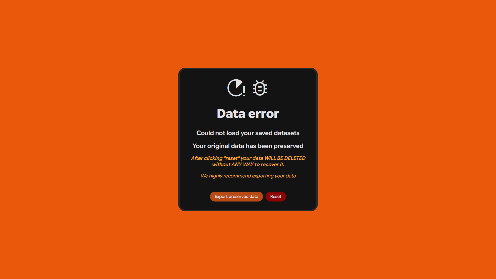

# Graph

Fast-Tools' data visualization tool!

## Features

- Dataset management
- Multiple graphs per dataset, each with its own data
- Multiple editable series per graph
- Bar, horizontal bar, stacked bar, pie, donut, line, area, radar, radial bar, polar area, treemap and heatmap charts
- Category management
- Editable category names and values
- Series management, including creation, renaming and removal
- Customizable series and slice colors
- Import and export datasets (JSON)
- Local data persistence
- Responsive layout
- Keyboard accessibility
- Error screens for corrupted data, failed saves and unavailable charts

## Technologies

- HTML
- CSS
- JavaScript

Uses ApexCharts for chart rendering.

## How to use

Open the tool directly [Here!](https://wirum.github.io/Fast-Tools/tools/graph/index.html)

To get started, create a dataset, then open Graph 1 or create a new graph.

To add data, open the customization menu and add your categories, values and series.

To change the chart type, open the Chart Types menu.

The cog icon in the corner opens the dataset settings. The graph icon beside it opens the graph settings.

The download and upload icons allow you to export the currently open dataset and import JSON files.

### Datasets

Datasets are the main containers for your graphs.

Create a new dataset using the **New Dataset** button.

You can select, rename or delete existing datasets.

A dataset only holds graphs. Each graph keeps its own categories and values.

Dataset names can't repeat when renaming (`Sales` and `sales` count as the same name).

### Graphs

Each dataset can contain multiple graphs, and each one has its own categories and values, so editing one never affects the others.

Create a graph inside a selected dataset using the **New Graph** button. New graphs start empty and are named `Graph 1`, `Graph 2`, etc., using the lowest available number.

You can rename or delete graphs through their configuration options. Names can't repeat inside the same dataset.

Select a graph to display its visualization. Each graph remembers its own chart type.

### Categories

Categories are the labels of a graph, so select a graph first.

You can:

- Add new categories
- Rename existing categories
- Edit their values
- Change their colors (Pie and Donut charts)
- Remove categories

Empty values count as `0`, and decimals are supported.

The chart updates while you type, and the value is saved when you leave the field.

### Series

Graphs can contain multiple data series.

You can:

- Create new series
- Select a series to edit
- Rename existing series
- Change series colors
- Remove series

Each series has its own values for the graph's categories.

Pie and Donut charts use individual slices instead of regular data series.

### Chart types

Graph currently supports **12 chart types**:

- **Bar:** Standard vertical bar chart.
- **Horizontal Bar:** Bar chart with horizontal bars.
- **Stacked Bar:** Combines multiple series into stacked bars.
- **Pie:** Displays values as slices of a circle.
- **Donut:** Similar to Pie, but with a hollow center.
- **Line:** Displays data points connected by lines.
- **Area:** Line chart with the area below it filled in.
- **Radar:** Displays data across multiple axes in a radar-shaped visualization.
- **Radial Bar:** Displays values using circular bars.
- **Polar Area:** Displays values as sectors with varying radii.
- **Treemap:** Displays hierarchical proportions using nested rectangles.
- **Heatmap:** Uses color intensity to represent values across categories and series.

You can switch between chart types without losing the graph's existing data.

### Import and export

The download icon exports the open dataset as a JSON file.

The upload icon imports a JSON file or a list of datasets.

Files with an invalid structure are rejected, and no existing data is changed.

### Data Storage

All datasets are saved using the browser's `localStorage`.

This means your data stays available after refreshing or reopening the page.

However, data is stored locally in your browser. It won't automatically synchronize across different devices or browsers.

The saved data is checked every time the page loads. Old or unsupported formats aren't automatically converted. Instead, the Data Error screen appears, allowing you to export your data before resetting.

### When things go wrong

- **Broken data:** The Data Error screen allows you to export your data or reset it.
- **Saving fails:** The Storage Failure screen provides the same options.
- **`localStorage` unavailable:** A message appears with a **Retry** button.
- **ApexCharts doesn't load:** A "Chart unavailable" message appears with a **Retry** button. You can still edit your data, but charts won't be displayed.

The application also displays console warnings when an operation attempts to save data while storage is unavailable. These warnings alert developers that further changes may put unsaved data at risk.

### Testing Error Screens

Graph includes built-in testing triggers for its error screens.

Open the browser developer console (`F12`) and use the following variables:

- `forceDataError = true`: Triggers the Orange Screen of Death (OSOD).
- `forceStorageUnavailable = true`: Triggers the Storage Unavailable screen.
- `forceNonCrashError = true`: Triggers a test Non-Crash modal.

After setting the desired variable to `true`, execute:

```js
testOSOD();
```

Each trigger resets itself to `false` after execution.

**IMPORTANT:** These triggers are for testing purposes only. They do not overwrite or modify your saved datasets.

### OSOD Counter (mid-development)

- OSOD Counter: 3

## Screenshots

### Current





## FOR THE REVIEWER

I'm open to suggestions!

If you find something that could be improved, feel free to let me know.

I plan a massive tool revamp when I get to my school break (after December 5th).

## AI USE

AI tools were used during development for assistance with CSS, debugging and code review.

All generated suggestions were reviewed before implementation. Code was tested and manually adjusted to ensure it worked as intended.

JavaScript also received some AI assistance, although not as much.

The most significant use of AI was identifying potential bugs and helping with testing.

AI was also used to help with my English.

## License

MIT License.