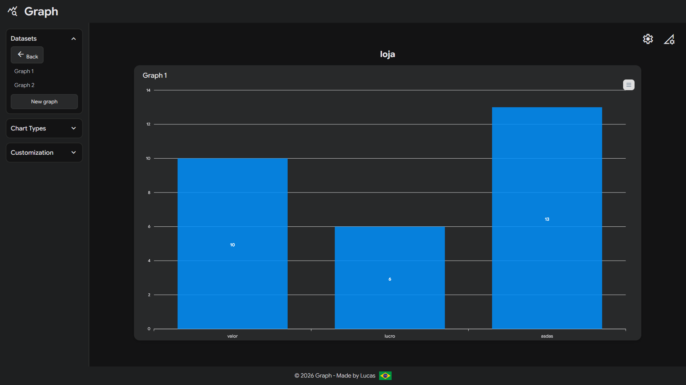

# Graph

Fast-Tools' data visualization tool!

## Features

- Dataset management
- Multiple graphs per dataset, each with its own data
- Bar, line and area charts
- Category management
- Editable category names and values
- Export and import datasets (JSON)
- Local data persistence
- Error screens for broken data, failed saves and charts that don't load

## Technologies

- HTML
- CSS
- JavaScript

Uses ApexCharts for chart rendering.

## How to use

Open the direct tool link [Here!](https://lukazzdev-temp.netlify.app/)

To use, create a dataset, open graph 1 or create a new graph

To add data open customization menu and add your categories and values.

To change the chart type (bar, line or area), open the Chart Types menu.

The cog in the corner is for the dataset's settings, the graph symbol beside it it's for the graph's settings. The download and upload icons export the open dataset and import a JSON file.

### Datasets

Datasets are the main containers for your graphs.

Create a new dataset using the **New Dataset** button.

You can select, rename or delete existing datasets.

A dataset only holds graphs. Each graph keeps its own categories and values.

Dataset names can't repeat when renaming (`Sales` and `sales` count as the same name).

### Graphs

Each dataset can contain multiple graphs, and each one has its own categories and values, so editing one never touches the others.

Create a graph inside a selected dataset using the **New Graph** button. New graphs start empty and are named `Graph 1`, `Graph 2`... using the lowest free number.

You can rename or delete graphs through their configuration options. Names can't repeat inside the same dataset.

Select a graph to display its visualization. Each graph remembers its own chart type.

### Categories

Categories are the labels of a graph, so select a graph first.

You can:

- Add new categories
- Rename existing categories
- Edit their values
- Remove categories

Empty values count as `0` and decimals work. The chart updates while you type and the value is saved when you leave the field.

### Import and export

The download icon exports the open dataset as a JSON file. The upload icon imports one (or a list of them). Files with the wrong structure are rejected and nothing changes.

### Data Storage

All datasets are saved using the browser's `localStorage`.

This means your data stays available after refreshing or reopening the page.

However, data is stored locally on your browser. It won't automatically synchronize across different devices or browsers.

The saved data is checked every time the page loads. Old or unsupported formats aren't converted, you get the Data Error screen instead (you can export your data from there before resetting).

### When things go wrong

- Broken data: Data Error screen, where you can export your data or reset
- Saving fails: Storage Failure screen, same options
- `localStorage` unavailable: message with a **Retry** button
- ApexCharts doesn't load: "Chart unavailable" message with a **Retry** button. You can still edit your data, but no charts

### Testing the Data Error Screen

To simulate corrupted localStorage data:

1. Open the Graph application.
2. Open the browser developer console (`F12`).
3. Execute the following command:

   ```js
   localStorage.setItem("datasets", "not-json");
   ```

4. Reload the page (`Ctrl + R`).

The Orange Screen of Death should appear, allowing you to test the data recovery interface.

For valid JSON with the wrong structure (a series with fewer values than categories), try this one instead:

```js
localStorage.setItem("datasets", '[{"id":"1","name":"x","graphs":[{"id":"2","name":"g","type":"bar","categories":["A","B"],"series":[{"name":"S","data":[1]}]}]}]');
```

**IMPORTANT WARNING:** These commands overwrite the current `datasets` entry in localStorage. Use them only in a test environment.

### OSOD COUNTER (mid development)

- OSOD COUNTER: 2

## What's missing (for V3)

- Several series per graph (only the first one is editable for now)
- Responsive layout
- Better accessibility
- Auto-recovery for invalid data
- Remembering the selected dataset and graph after reloading

## Screenshots

### Current





## FOR THE REVIEWER

I'm open to suggestions!

If you find something that could be improved, feel free to let me know.

And again i didn't have much time this week. (finals 💀💀)

I plan a massive tool revamp when i get onto my school break (past 5 december)

## AI USE

AI tools were used during development for assistance with CSS, debugging and code review.

All generated suggestions were reviewed before implementation. Code was tested and adjusted manually to ensure it worked as intended.

And i read through all its awnsers before pasting, and made improvements/changes to its code. No code was pasted without verifying.

JS also had some AI help. Not much also.

The most use of AI was to find potential bugs and testing.

*and also to help with my bad english.*

## License

MIT License.