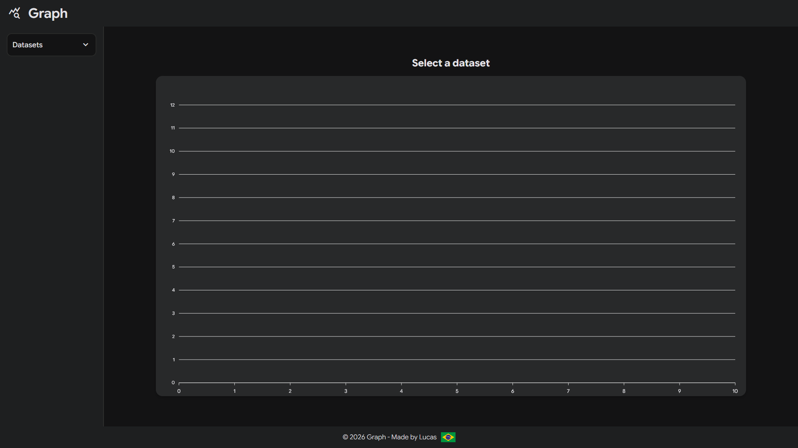

# Graph

Fast-Tools' data visualization tool!

## Features

- Dataset management
- Multiple graphs per dataset
- Category management
- Editable category names and values
- Data visualization
- Local data persistence

## Technologies

- HTML
- CSS
- JavaScript

Uses ApexCharts for chart rendering.

## How to use

Open the direct tool link [Here!](https://wirum.github.io/Fast-Tools/tools/graph/index.html)

### Datasets

Datasets are the main containers for your data.

Create a new dataset using the **New Dataset** button.

You can select, edit or delete existing datasets.

Each dataset stores its own categories and graphs.

### Categories

Categories represent the data labels used by your graphs.

You can:

- Add new categories
- Rename existing categories
- Edit their values
- Remove categories

Changes are automatically reflected in the associated graph.

### Graphs

Each dataset can contain multiple graphs.

Create a graph inside a selected dataset using the **New Graph** button.

You can rename or delete graphs through their configuration options.

Select a graph to display its visualization.

### Data Storage

All datasets are saved using the browser's `localStorage`.

This means your data stays available after refreshing or reopening the page.

However, data is stored locally on your browser. It won't automatically synchronize across different devices or browsers.

## Screenshots

### Current

## FOR THE REVIEWER

I'm open to suggestions!

If you find something that could be improved, feel free to let me know.

## AI USE

AI tools were used during development for assistance with CSS, debugging and code review.

All generated suggestions were reviewed before implementation. Code was tested and adjusted manually to ensure it worked as intended.

*and also to help with my bad english.*

## License

MIT License.